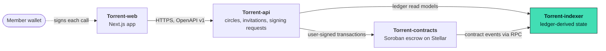

<div align="center">


# Torrent-indexer

**Ledger-derived read models for Torrent: pools, payout rights and transfers rebuilt from Soroban contract events.**

[](https://github.com/Torrent998/Torrent-indexer/actions/workflows/ci.yml)
[](https://github.com/Torrent998/Torrent-indexer/actions/workflows/docs.yml)
[](./LICENSE)
[](#status)
[](#security)
[](./package.json)

[Live app](https://torrent-web1.vercel.app) · [Docs](https://github.com/Torrent998/Torrent-web/tree/main/gitbook) · [Quick start](#quick-start) · [Live status](https://torrent-indexer.onrender.com/v1/status) · [Architecture](./docs/ARCHITECTURE.md) · [Contributing](./CONTRIBUTING.md)

</div>

---

## What this is

Torrent lets savings-circle members trade the timing of a payout, but only for payouts that are already fully funded. The money and the rules live in a Soroban
contract. The indexer reads that contract's events from Stellar RPC and rebuilds, deterministically, what is true on the ledger: which pools exist, who owns which
payout right, which transfers are open, and how much is funded, reserved and claimed. The API and the web app trust this read model instead of their own databases,
and the indexer refuses any event stream that breaks the contract's rules.

## Status

Torrent is a **Testnet prototype with synthetic funds. It has not been audited.**

| Area | State |
|---|---|
| Strict decoder for all 22 ABI v2 events | implemented, tested on the real events recorded from the contract (`fixtures/contract-stream.v2.json`) |
| Deterministic projection of pools, members, rights, transfers, totals and governance | implemented; it rejects activity in a closed pool, an offer on a matured right, a member leaving while owning a right, an upgrade before its timelock |
| Reconciliation against the contract's own `get_totals`, `get_right`, `get_pool`, `get_governance` | implemented; ran on its schedule against Testnet with no fault. A forced drift was **not** exercised live, only in unit tests |
| Durable cursor, dedup, replay and backfill, reorg rollback, fail-closed faults | implemented, failure paths tested (SQLite in WAL mode, cursor committed atomically with events) |
| Read-only HTTP API and JSON Schema snapshot | implemented |
| Live on Stellar Testnet | **yes**: follows [`CBWF73FUJDGXSXOYUVYHP3XAFSPZWX65YGFSXDSSF5VRFLEWFFTQUIJG`](https://stellar.expert/explorer/testnet/contract/CBWF73FUJDGXSXOYUVYHP3XAFSPZWX65YGFSXDSSF5VRFLEWFFTQUIJG) from ledger 5553711. Hosted at [torrent-indexer.onrender.com](https://torrent-indexer.onrender.com/v1/status) (Render free plan: it sleeps when idle and the first request can take 50 seconds or more) |
| Observed on Testnet | `SYNCED`, 54 events ingested, `reorgCount 0`, no faults. For the smoke pool the indexer's totals (`funded 10000000, claimed 6000000, withdrawn 4000000, reserved 0`) equal the contract's own `get_totals` |
| Tests | 78 passing; `tests/helpers/fake-ledger.ts` is a labeled test adapter that replays recorded events |
| Admin shown by `GET /v1/contract` | `null` until the first admin rotation: the contract constructor emits no event (a contract change, tracked as an open issue) |
| Security audit, Mainnet, production use | **no**, **no**, **no** |

## How it fits together

Torrent is four repositories, each owning one boundary. The contract is the only source of truth for backing, ownership and payout. This repository rebuilds that truth from
the ledger so nothing else has to guess.



| Repository | Stack | Owns |
|---|---|---|
| [Torrent-contracts](https://github.com/Torrent998/Torrent-contracts) | Rust, Soroban SDK 29 | Escrow pools, fully backed payout rights, member-only transfers, one-time claims |
| **[Torrent-indexer](https://github.com/Torrent998/Torrent-indexer)** (this repo) | TypeScript, Node 22, Stellar RPC | Event ingestion with a durable cursor and the read models |
| [Torrent-api](https://github.com/Torrent998/Torrent-api) | TypeScript, NestJS, SQLite | Circles, invitations, wallet sign-in, the signing-request state machine |
| [Torrent-web](https://github.com/Torrent998/Torrent-web) | TypeScript, Next.js 16, Tailwind CSS 4 | Landing page and app, Freighter wallet adapter |

## HTTP API (read-only)

| Route | Returns |
|---|---|
| `GET /v1/ledger/events?cursor=&limit=` | Ingested contract events, paginated by cursor |
| `GET /v1/pools/:id`, `GET /v1/pools/:id/rights` | A pool with members and totals, and its payout rights |
| `GET /v1/rights/:id`, `GET /v1/transfers/:id` | One right, one transfer |
| `GET /v1/contract` | Governance: admin, pending upgrade and its timelock, upgrade lock, ABI version |
| `GET /v1/status`, `GET /healthz` | Sync state (cursor, lag, reorg count, faults), liveness |

The schema snapshot is in [`generated/ledger-events.schema.json`](./generated/ledger-events.schema.json) and the example responses in `generated/api-examples.v1.json`.

## Tech stack

| Layer | Tools |
|---|---|
| Runtime | Node.js 22.12 or newer, TypeScript (strict), no framework |
| Chain access | Stellar RPC (`getEvents`, `simulateTransaction`) |
| Storage | SQLite through `node:sqlite` (experimental in Node 22), WAL mode; a JSON store remains for tests |
| Tests | Vitest, recorded contract events as fixtures |
| CI | GitHub Actions: lint, typecheck, tests, build, `npm audit --omit=dev --audit-level=high` |

## Quick start

Requires Node.js 22.12 or newer.

```bash
git clone https://github.com/Torrent998/Torrent-indexer && cd Torrent-indexer
npm ci
npm run check            # eslint, typecheck, vitest, build
cp .env.example .env     # set TORRENT_ESCROW_CONTRACT_ID and CHAIN_START_LEDGER
npm start                # http://localhost:3002  (/healthz, /v1/status)
```

For the Testnet contract, set `TORRENT_ESCROW_CONTRACT_ID=CBWF73FUJDGXSXOYUVYHP3XAFSPZWX65YGFSXDSSF5VRFLEWFFTQUIJG` and `CHAIN_START_LEDGER=5553711`.
`npm start` loads `.env` when present and refuses to start without the required settings or on a non-Testnet network. State is SQLite at `DATABASE_PATH`
(default `data/indexer.db`, git-ignored). Stop with Ctrl-C or SIGTERM: the tick in flight finishes, then the process exits.

| Variable | Default | Meaning |
|---|---|---|
| `TORRENT_ESCROW_CONTRACT_ID` | none, required | Contract to follow |
| `CHAIN_START_LEDGER` | `0` | Ledger to backfill from (use the deploy ledger) |
| `STELLAR_RPC_URL` | `https://soroban-testnet.stellar.org` | Soroban RPC endpoint |
| `POLL_MS` | `5000` | Poll interval |
| `PAGE_SIZE` | `100` | Events per RPC page |
| `CONFIRMATIONS` | `1` | Ledgers to wait before treating an event as final |
| `RECONCILE_EVERY_TICKS` | `60` | Reconciliation period in ticks |
| `DATABASE_PATH` | `data/indexer.db` | SQLite file |
| `PORT` | `3002` | HTTP port |

## Project structure

```text
src/ledger/      event decoder, projection (the rules it enforces), error types, ABI spec mirror
src/indexer/     the tick loop with cursor, dedup and reorg handling; stores (SQLite and JSON)
src/rpc/         Soroban RPC event source and the chain reader used for reconciliation
src/http/        read-only HTTP server
fixtures/        the contract's real recorded events, scenario and ABI mirror (ABI v2)
generated/       JSON Schema and API example snapshots
tests/           decoder, projection, reconciliation, store, HTTP, spec-mirror tests
docs/            architecture, contract specification, security model, deployment notes, ADRs
```

Design record: [ADR 0001](./docs/adr/0001-indexer-design.md). Contract specification: [docs/STELLAR_PROTOCOL.md](./docs/STELLAR_PROTOCOL.md).

## Contributing

Contributions are welcome and Torrent takes part in the Stellar Wave program on Drips. Open, scoped tasks carry the
[`Stellar Wave`](https://github.com/Torrent998/Torrent-indexer/issues?q=is%3Aissue+is%3Aopen+label%3A%22Stellar+Wave%22) label and one complexity label
(`trivial`, `medium` or `high`). Read [CONTRIBUTING.md](./CONTRIBUTING.md) first. Fixtures change only from the contract's real event stream.

## Security

Unaudited prototype, Testnet only, synthetic funds only. Report vulnerabilities privately through GitHub's
[private vulnerability reporting](https://github.com/Torrent998/Torrent-indexer/security/advisories/new) as described in [SECURITY.md](./SECURITY.md).
The threat model is in [docs/SECURITY.md](./docs/SECURITY.md).

## Community

Questions and design discussion: [GitHub Discussions](https://github.com/Torrent998/Torrent-indexer/discussions).

## Maintainers

| Maintainer | Role | Link |
|---|---|---|
| Cjay | Maintainer, all four Torrent repositories | [@Cjay-Cyber-2](https://github.com/Cjay-Cyber-2) |

Organization: [Torrent998](https://github.com/Torrent998).

## Contributors

<a href="https://github.com/Torrent998/Torrent-indexer/graphs/contributors">
  
</a>

## License

[MIT](./LICENSE)
